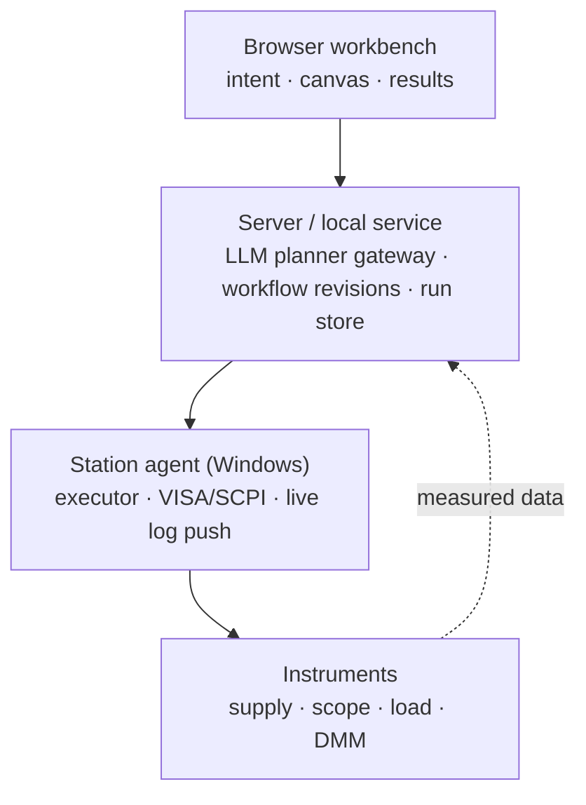

# TestFlow Studio

> Describe a test in one sentence → get a structured workflow → run it against instruments → generate a report from measured results.
> A zero-dependency, open-in-browser **prototype** of an AI-native test automation workbench.

[](https://github.com/limingwan31/testflow-studio/actions/workflows/ci.yml)
[](LICENSE)
[](https://nodejs.org/)
[](CONTRIBUTING.md)

**Language**: [简体中文](README.md) · [English](README.en.md)

> ⚠️ **Disclaimer**: This is an independent, from-scratch open-source prototype. Its product shape was inspired by the publicly described product at [testflowinc.com](https://testflowinc.com/), but it contains **no code, assets or documentation** from TestFlow Inc. and is **not affiliated with, endorsed by, or sponsored by** them. "TestFlow" and related marks belong to their respective owners. See [NOTICE.md](NOTICE.md).

---

## Why this exists

The slow part of hardware validation is rarely writing a single SCPI command. It is the handoff between four jobs: turning intent into an executable workflow, driving real instruments from a station PC, watching measurements live, and producing a report that can actually be signed off.

This repository implements that loop as a minimal, readable reference:

```
Test intent → Planner workflow JSON → Engine executes steps → Report renders measured results
     ↑                                                              │
     └──────── run history / revisions / trends ←────────────────────┘
```

**This is a reference implementation, not a production test executive.** The goal is to make the architecture, data contract and safety boundaries explicit so you can rebuild them in your own stack.

## Features

| Capability | Details |
| --- | --- |
| Pluggable drivers | 4 simulated SCPI instruments (supply / scope / electronic load / DMM) plus 2 placeholder drivers (Modbus, HTTP). Commands come only from an allowlist of capability definitions |
| Natural-language planning | One Chinese or English sentence produces a workflow JSON: voltage range, step size, limits, load current and channel are parsed. Devices, capabilities and limit provenance are validated before execution |
| Workflow canvas | Loops and sweeps, editable parameters, reorder / delete / add steps, `Rev A/B/C` revisions |
| Execution engine | Step-by-step execution, live event stream, per-point PASS/FAIL checks, `finally` turns outputs off |
| Results & reports | Results table, worst-case vs limits, measured waveform SVG, CSV / Markdown export, print to PDF |
| Run history | Every run is bound to a workflow revision and can be reloaded and rerun (localStorage) |
| Chinese / English UI | Interface, instrument names, canvas, logs, exported reports and help pages all follow the language switch |
| Dark / light themes | 47 light-theme overrides, waveform recolors too; preference persists with no flash on reload |

## Quick start

### Option 1: just open it (zero install)

Double-click [`index.html`](index.html). No ES modules, no build step, no CDN — it runs directly in the browser.

### Option 2: local static server

```bash
git clone https://github.com/limingwan31/testflow-studio.git
cd testflow-studio
node scripts/serve.js          # or: npm run serve
# open http://localhost:8080
```

### Verification

```bash
node scripts/verify.js         # syntax, asset references, DOM ids, required docs
node tests/smoke.js            # full loop + i18n + themes
npm run verify                 # both (no npm install required)
```

Requires Node.js ≥ 18. **There are no runtime dependencies and no `npm install` step.**

## Using it

1. Type a test intent, for example:
   `Sweep 5-20 V supply, capture the rail transient on CH1, overshoot limit 200 mV, 2.5 A load`
   Chinese works too: `扫 5-20 V 电源，在 CH1 捕获负载瞬态，过冲限值 200 mV，2.5 A 负载`
2. Click **Generate workflow**. The canvas shows `Loop × 4` and the individual steps. Use ✎ to edit parameters, ↑↓ to reorder, × to delete, and `+ Step` to add an action by device and capability.
3. Click **Run**. The execution log streams commands and measured values; the results table, waveform and verdict appear below.
4. Export CSV / Markdown, print to PDF, or reload any revision from the run history and rerun it.
5. Use the top-right **中文 / EN** and theme controls; preferences are remembered.

See [docs/USER_GUIDE.md](docs/USER_GUIDE.md) for a full walkthrough.

## Architecture



| This prototype | Production counterpart |
| --- | --- |
| `src/drivers.js` | OpenTAP Instrument / SCPI plugins + capability definitions |
| `src/planner.js` | LLM via OpenTAP MCP returning structured step JSON |
| `src/engine.js` | OpenTAP TestPlan engine + ResultListener |
| `src/report.js` | Template engine rendering run results → PDF / Excel |
| `src/app.js` | ASP.NET Core + Blazor Server / SignalR |
| `localStorage` | PostgreSQL / SQLite + workflow revision store |

**Why OpenTAP**: 9.35+ ships an MCP Server, TestStep / Instrument / ResultListener plugin model and parameter sweeps, under MPL-2.0 with proprietary plugins allowed — it saves writing a sequencer from scratch. This project only recommends it and includes none of its code.

See [docs/ARCHITECTURE.md](docs/ARCHITECTURE.md) for the full design.

## Workflow JSON contract

Workflow field names are Chinese and act as a **stable contract** (`类型`, `能力`, `参数`, `限值`…). Switching the UI language translates only the presentation layer; the JSON itself never changes, otherwise the engine, validation rules and stored revisions would all break together.

```json
{
  "名称": "PSU 负载瞬态测试",
  "修订号": "Rev A",
  "限值": { "过冲上限": 200, "来源": "用户输入", "锁定": true },
  "变量": { "扫描电压": [5, 10, 15, 20] },
  "步骤": [
    { "类型": "开始", "标题": "Start" },
    { "类型": "循环", "变量": "扫描电压", "取值": [5, 10, 15, 20], "子步骤": [
      { "类型": "动作", "设备": "psu-01", "能力": "set_voltage",
        "参数": { "电压": "${扫描电压}" }, "命令来源": "驱动能力定义文件（AI 不生成命令）" }
    ] },
    { "类型": "结束", "标题": "End" }
  ]
}
```

An `动作` (action) contains a **capability name only**, never a command string. `VOLT {电压},(@2)` comes from the capability definitions in `drivers.js` and can be previewed before anything runs.

## Four safety guardrails

These are the line between a trustworthy hardware test platform and a dangerous one. Please do not weaken them in derived projects:

1. **Command allowlist** — the model may only reference capability names; SCPI / Modbus strings come exclusively from driver capability definitions.
2. **Locked limits** — limits come from user input and published workflows are immutable; AI cannot relax a limit to make a test pass or declare a PASS without a run.
3. **Data provenance** — every number in a report comes from the run record and is filled by template code; the model only writes purpose, setup notes and deviation notes.
4. **Fail-safe** — `*RST` / `*CLS` first, set OVP / OCP before `OUTP ON`, read `SYST:ERR?` after each configuration block, always turn output and load off in `finally`.

## Known limitations

- **Simulated instruments only** — no real VISA / Modbus / HTTP communication; connecting hardware requires a driver adapter.
- No user or operator permissions, audit log, results database or multi-station sync.
- No DAQ cards, no hard real-time HIL, and no command timeouts, busy handling, retries or reconnect recovery.
- Workflow revisions live in localStorage rather than an immutable store; reports are CSV / Markdown / printed PDF, with no built-in PDF generator.
- The planner is deterministic rule parsing, not an LLM — but it exposes the exact interface an LLM / MCP implementation would use.

See [docs/ROADMAP.md](docs/ROADMAP.md) for the full list and priorities.

## Documentation

| Doc | Contents |
| --- | --- |
| [docs/ARCHITECTURE.md](docs/ARCHITECTURE.md) | Layers, modules, data flow, JSON contract, event protocol, extension points |
| [docs/USER_GUIDE.md](docs/USER_GUIDE.md) | Step-by-step usage, intent syntax, exports, reruns, FAQ |
| [docs/DEVELOPMENT.md](docs/DEVELOPMENT.md) | Adding drivers/capabilities, replacing the planner, connecting hardware, conventions, CI |
| [docs/ROADMAP.md](docs/ROADMAP.md) | Roadmap and known limitations |
| [CONTRIBUTING.md](CONTRIBUTING.md) | Contribution workflow and checklist |
| [SECURITY.md](SECURITY.md) | Security policy and safety boundaries |
| [CODE_OF_CONDUCT.md](CODE_OF_CONDUCT.md) | Community code of conduct |
| [CHANGELOG.md](CHANGELOG.md) | Release history |
| [NOTICE.md](NOTICE.md) | Third-party and trademark notices |

## Contributing

Issues, PRs and discussions are welcome. Run `npm run verify` before submitting and make sure both languages, both themes and all safety guardrails still hold. See [CONTRIBUTING.md](CONTRIBUTING.md).

## License

[Apache License 2.0](LICENSE) © 2026 liming. See [NOTICE.md](NOTICE.md) for trademark and third-party notices.
