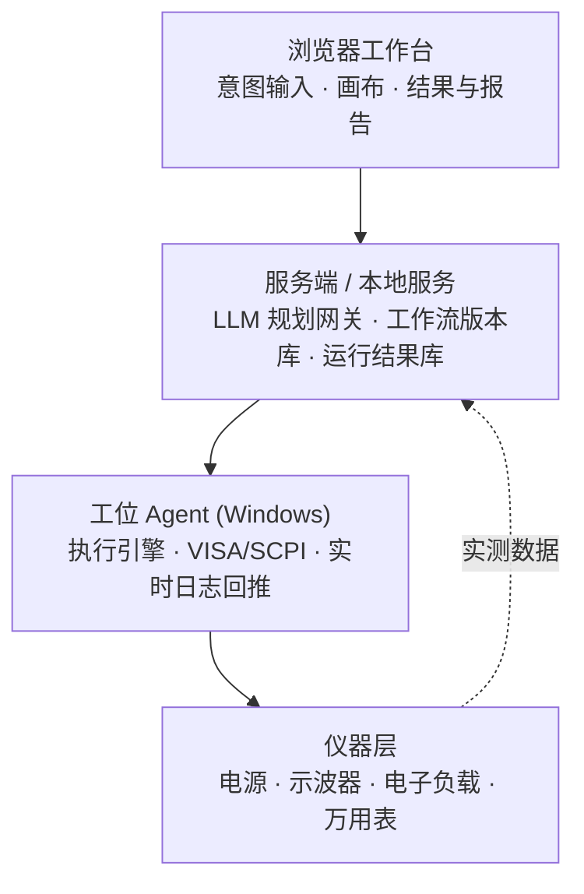

# TestFlow Studio

> 一句话描述测试 → 结构化工作流 → 驱动仪器执行 → 由实测结果生成可审计报告。
> 一个零依赖、可直接打开的 AI 原生测试自动化工作台**原型**。

[](https://github.com/limingwan31/testflow-studio/actions/workflows/ci.yml)
[](https://limingwan31.github.io/testflow-studio/)
[](LICENSE)
[](https://nodejs.org/)
[](CONTRIBUTING.md)

**语言 / Language**：[简体中文](README.md) · [English](README.en.md)

> ⚠️ **关系声明**：本项目是独立从零编写的开源原型，功能形态参考了 [testflowinc.com](https://testflowinc.com/) 公开描述的产品，但**不含其任何代码、素材或文档内容，也与其无关联、未获其背书**。「TestFlow」及相关标识归各自权利人所有。详见 [NOTICE.md](NOTICE.md)。

---

## 它解决什么问题

硬件/设备测试的慢，通常不在"写一句 SCPI"，而在四个环节之间的交接：**把测试意图变成可执行流程 → 在工位机上驱动真实设备 → 实时看到测量值 → 把结果变成能签字归档的报告**。

本项目把这条闭环做成一个可以直接跑起来的最小实现：

```
测试意图  →  Planner 结构化工作流  →  Engine 逐步执行  →  Report 由实测数据渲染
   ↑                                                              │
   └──────────── 运行历史 / 版本复跑 / 趋势数据 ←────────────────┘
```

**它是参考实现，不是生产级测试执行器。** 目的是把架构、数据契约和安全边界讲清楚，方便你在自己的技术栈里重建。

## 功能一览

| 能力 | 说明 |
| --- | --- |
| 可插拔驱动层 | 4 台模拟 SCPI 仪器（电源 / 示波器 / 电子负载 / 万用表）+ 2 个占位驱动（Modbus、HTTP）。命令只来自能力定义白名单 |
| 自然语言规划 | 中文或英文一句话生成结构化工作流 JSON，支持电压范围、步进、限值、负载电流、通道解析；带设备/能力/限值来源白名单校验 |
| 工作流画布 | 循环与扫描、步骤参数编辑、上下移动、删除、手动添加步骤；Rev A/B/C 版本递增 |
| 执行引擎 | 逐步执行、实时事件流、逐点 PASS/FAIL 判定、`finally` 关闭输出 |
| 结果与报告 | 结果表格、最差值对比限值、实测波形 SVG、CSV / Markdown 导出、打印为 PDF |
| 运行历史 | 每次 run 绑定工作流版本，可载入并一键复跑（localStorage 持久化） |
| 中英双语 | 界面、设备名、画布、日志、导出报告、帮助页全部随语言切换 |
| 深浅主题 | 47 条浅色覆盖规则，波形图同步换色；偏好持久化，刷新不闪屏 |

## 快速开始

### 方式零：在线演示（无需安装，推荐给访客）

**https://limingwan31.github.io/testflow-studio/**

由 GitHub Pages 静态托管，打开即用，功能与本地 `index.html` 完全一致：中英切换、深浅主题、
工作流编辑、运行与日志、结果表格与波形、CSV / Markdown 导出、运行历史与一键复跑。
页面是纯静态的，**没有后端、不连接任何真实仪器**；语言 / 主题偏好与运行历史只保存在浏览器
`localStorage`，不会上传到服务器。

### 方式一：直接打开（零安装，本地）

双击 [`index.html`](index.html)。项目不使用 ES modules、构建工具或 CDN，浏览器直接打开即可运行。

### 方式二：本地静态服务器

```bash
git clone https://github.com/limingwan31/testflow-studio.git
cd testflow-studio
node scripts/serve.js          # 或 npm run serve
# 打开 http://localhost:8080
```

### 运行校验

```bash
node scripts/verify.js         # 语法、资源引用、DOM id、必需文档
node tests/smoke.js            # 闭环 + 双语 + 双主题冒烟测试
npm run verify                 # 两者一起跑（无需 npm install）
```

要求 Node.js ≥ 18，**没有运行时依赖，也不需要 `npm install`**。

## 界面与操作

1. 在「测试意图」输入一句话，例如：
   `扫 5-20 V 电源，在 CH1 捕获负载瞬态，过冲限值 200 mV，2.5 A 负载`
   英文也可以：`VI sweep from 1 to 10 V in 1 V steps at 0.5 A load, limit 150 mV`
2. 点 **生成工作流**，画布出现 `Loop × 4` 与各步骤；点击 ✎ 可改参数，↑↓ 可排序，× 可删除，`+ 步骤` 可按"设备 → 能力"追加动作。
3. 点 **运行**，右侧「执行日志」逐步流式输出命令与实测值，底部结果表格、波形与 PASS/FAIL 同步生成。
4. 导出 CSV / Markdown 报告，或打印为 PDF；左侧「运行历史」可载入任一版本复跑。
5. 右上角切换 **中文 / EN** 与 **深浅主题**，偏好会记住。

更详细的操作说明见 [docs/USER_GUIDE.md](docs/USER_GUIDE.md)。

## 架构



| 本原型 | 正式平台建议 |
| --- | --- |
| `src/drivers.js` | OpenTAP Instrument / SCPI 插件 + 能力定义文件 |
| `src/planner.js` | LLM 经 OpenTAP MCP 返回结构化步骤 JSON |
| `src/engine.js` | OpenTAP TestPlan 执行引擎 + ResultListener |
| `src/report.js` | 模板引擎渲染 run 结果文件 → PDF / Excel |
| `src/app.js` | ASP.NET Core + Blazor Server / SignalR |
| `localStorage` | PostgreSQL / SQLite + 工作流版本库 |

**为什么推荐 OpenTAP**：9.35+ 已内置 MCP Server、TestStep / Instrument / ResultListener 插件模型与参数扫描，MPL-2.0 且插件可闭源，能省掉自己写 sequencer 的工作量。本项目仅作推荐，未包含其任何代码。

完整设计见 [docs/ARCHITECTURE.md](docs/ARCHITECTURE.md)。

## 目录结构

```
├── index.html              工作台入口（双击即可）
├── assets/styles.css       深色 / 浅色主题
├── src/
│   ├── i18n.js             多语言与主题、持久化、重绘回调
│   ├── drivers.js          可插拔驱动注册表 + 命令白名单
│   ├── planner.js          中英意图 → 工作流 JSON、白名单校验
│   ├── engine.js           循环/扫描执行、事件流、限值判定
│   ├── report.js           CSV / Markdown / 波形 SVG
│   └── app.js              界面渲染与交互
├── scripts/                verify.js（静态校验）、serve.js（本地服务器）
├── tests/smoke.js          零依赖端到端冒烟测试
└── docs/                   架构、使用、开发、路线图
```

## 工作流 JSON 契约

工作流字段使用中文作为**稳定契约**（`类型`、`能力`、`参数`、`限值`…）。切换界面语言只翻译展示层，不改动这份 JSON，否则引擎、校验规则和历史快照会一起失效。

```json
{
  "名称": "PSU 负载瞬态测试",
  "修订号": "Rev A",
  "限值": { "过冲上限": 200, "来源": "用户输入", "锁定": true },
  "变量": { "扫描电压": [5, 10, 15, 20] },
  "步骤": [
    { "类型": "开始", "标题": "Start" },
    { "类型": "循环", "变量": "扫描电压", "取值": [5, 10, 15, 20], "子步骤": [
      { "类型": "动作", "设备": "psu-01", "能力": "set_voltage",
        "参数": { "电压": "${扫描电压}" }, "命令来源": "驱动能力定义文件（AI 不生成命令）" }
    ] },
    { "类型": "结束", "标题": "End" }
  ]
}
```

注意 `动作` 里只有**能力名**，没有命令字符串。`VOLT {电压},(@2)` 由 `drivers.js` 的能力定义生成，执行前可完整预览。

## 四条安全护栏

这是硬件测试平台能不能被信任的分界线，请勿在派生项目里削弱：

1. **命令白名单** — 模型只能引用能力名，SCPI / Modbus 命令字符串一律来自驱动能力定义文件。
2. **限值锁定** — 限值来自用户输入，工作流发布后不可变；AI 不能放宽限值让测试通过，也不能凭空声明 PASS。
3. **数据溯源** — 报告里每个数字都来自运行记录并由模板代码填充；模型只写目的、设置说明与偏差备注。
4. **失效安全** — 先 `*RST` / `*CLS`，先设 OVP / OCP 再 `OUTP ON`，每个配置块后读 `SYST:ERR?`，`finally` 中必须关闭输出与负载。

## 已知限制

- 只带**模拟仪器**，没有真实 VISA / Modbus / HTTP 通信；接真机需实现驱动适配器。
- 没有用户与操作员权限、审计日志、结果数据库、多工位同步。
- 不支持 DAQ 卡、硬实时 HIL，也没有命令超时、仪器忙、重试与断连恢复。
- 工作流版本目前存于 localStorage，非不可变发布；导出报告为 CSV / Markdown / 打印 PDF，未内置 PDF 生成器。
- 规划器是确定性规则解析，不是大模型；它预留了与 LLM / MCP 完全一致的接口。

完整清单与优先级见 [docs/ROADMAP.md](docs/ROADMAP.md)。

## 文档索引

| 文档 | 内容 |
| --- | --- |
| [docs/ARCHITECTURE.md](docs/ARCHITECTURE.md) | 分层架构、模块职责、数据流、JSON 契约、事件协议、扩展点 |
| [docs/USER_GUIDE.md](docs/USER_GUIDE.md) | 逐步操作、意图写法、导出与复跑、常见问题 |
| [docs/DEVELOPMENT.md](docs/DEVELOPMENT.md) | 添加驱动/能力、替换 Planner、接真机、编码约定、测试与 CI |
| [docs/ROADMAP.md](docs/ROADMAP.md) | 路线图与已知限制 |
| [CONTRIBUTING.md](CONTRIBUTING.md) | 贡献流程与检查清单 |
| [SECURITY.md](SECURITY.md) | 安全政策与安全边界 |
| [CODE_OF_CONDUCT.md](CODE_OF_CONDUCT.md) | 社区行为准则 |
| [CHANGELOG.md](CHANGELOG.md) | 版本变更记录 |
| [NOTICE.md](NOTICE.md) | 与第三方产品/商标的关系声明 |

## 贡献

欢迎 Issue、PR 与讨论。提交前请跑 `npm run verify`，并确认中英双语、深浅主题、安全护栏都未被破坏。详见 [CONTRIBUTING.md](CONTRIBUTING.md)。

## 许可证

[Apache License 2.0](LICENSE) © 2026 liming。详见 [NOTICE.md](NOTICE.md) 中的商标与第三方声明。
