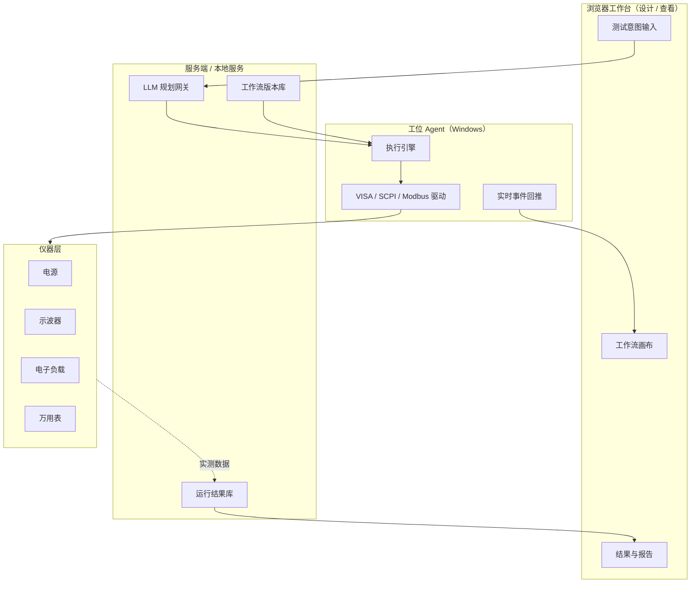

# 架构设计 / Architecture

> 本文描述原型的设计意图、数据契约与扩展点。面向想改造或重建它的人。

## 1. 设计目标与约束

| 目标 | 做法 |
| --- | --- |
| 把"意图 → 执行 → 报告"闭环讲清楚 | 六个模块，各自单一职责，无隐藏魔法 |
| 零安装即可运行 | 不用 ES modules、构建器、CDN；传统 `<script>` 顺序加载，`file://` 可用 |
| 被测对象可替换 | 驱动层只暴露"能力名"，协议细节封装在适配器里 |
| AI 不能直接控制带电设备 | 命令白名单 + 限值锁定 + 数据溯源 + 失效安全 |
| 双语与主题不污染数据 | 中文作为 JSON 契约，展示层才做翻译 |

**非目标**：生产级 sequencer、用户权限、结果数据库、硬实时控制、真实仪器通信。见 [ROADMAP.md](ROADMAP.md)。

## 2. 四层架构



原型把四层压缩在同一个浏览器页面里，但**职责边界仍然按层划分**，所以替换实现时不用重写上层：

| 层 | 原型实现 | 正式实现建议 |
| --- | --- | --- |
| 浏览器工作台 | `index.html` + `assets/styles.css` + `src/app.js` | ASP.NET Core / Blazor Server + MudBlazor，SignalR 推日志 |
| 服务端 | `src/planner.js`、`src/report.js`、localStorage | LLM 网关 + 工作流/结果数据库 + 报告服务 |
| 工位 Agent | `src/engine.js` + `src/drivers.js` 的模拟读数 | Windows 服务，持有 NI-VISA / 工业协议会话 |
| 仪器层 | `SimulatedAdapter`（`执行()` 内的确定性读数） | VisaScpiAdapter / ModbusTcpAdapter / HttpAdapter |

> 关键约束：**浏览器只做设计与查看，真正跑设备必须在工位机**。USB / GPIB / NI-VISA 不在浏览器沙箱里。

## 3. 模块与加载顺序

`index.html` 底部按依赖顺序加载，全部挂在 `window.FlowLab` 命名空间下：

| 顺序 | 文件 | 导出 | 职责 |
| --- | --- | --- | --- |
| 1 | `src/i18n.js` | `I18n` | 语言/主题状态、`tr()` 短语替换、静态文案应用、重绘回调注册 |
| 2 | `src/drivers.js` | `Drivers` | 能力定义（命令白名单）、设备注册表、`命令()`、`执行()` |
| 3 | `src/planner.js` | `Planner` | `解析()`、`生成()`、`校验()`、修订号 |
| 4 | `src/engine.js` | `Engine` | `运行()`、`停止()`、事件推送、运行记录 |
| 5 | `src/report.js` | `Report` | CSV / Markdown / 波形 SVG |
| 6 | `src/app.js` | — | DOM 渲染与交互，不含测量逻辑 |

依赖方向是单向的：`app → (I18n, Drivers, Planner, Engine, Report)`，`Engine → Drivers`，
`Report → I18n`，`Planner → Drivers`。没有循环依赖。

## 4. 数据流

```
描述文本
  │ Planner.解析()  → 电压序列 / 限值 / 电流 / 通道 / 时基
  ▼
工作流对象 ── Planner.校验() ──✗ 不通过则不进入引擎
  │
  ├─→ 画布渲染 + JSON 面板（只读契约）
  │
  ▼
Engine.运行(工作流, 回调)
  │  展开循环 → 逐步骤替换 ${扫描电压} → Drivers.命令() → Drivers.执行()
  │  事件流：阶段 / 步骤 / 日志 / 测量 / 判定 / 汇总 / 完成 / 错误
  ▼
运行记录（点位数组、事件数组、最差值、结论、波形）
  │
  ├─→ 结果表格 / 波形 SVG
  ├─→ CSV / Markdown 报告（只消费运行记录）
  └─→ 运行历史（绑定修订号，可复跑）
```

**数值只在第 4 步产生**：`Drivers.执行()` 返回测量值 → 写入运行记录 → 报告渲染。
`Planner` 和 `Report` 都不生成数值，语言模型更不参与。

## 5. 工作流 JSON 契约

字段名为中文且**不随界面语言变化**，因为它是引擎、校验规则、历史快照与未来 LLM 输出
共用的稳定契约。切换语言只翻译展示层。

| 字段 | 类型 | 说明 |
| --- | --- | --- |
| `名称` / `修订号` | string | 名称由意图推断；修订号 `Rev A/B/C…` |
| `描述` / `生成方式` / `创建时间` | string | 溯源信息 |
| `限值` | object | `过冲上限`、`下跌上限`、`纹波上限`、`稳定时间上限`、`单位`、`来源`（必须为 `用户输入`）、`锁定`（true） |
| `变量` | object | 目前只有 `扫描电压: number[]` |
| `步骤` | array | `开始` / `循环` / `结束` 三类顶层节点 |
| `安全预检` | string[] | 注入到执行日志的安全序列说明 |

步骤节点：

| 类型 | 关键字段 |
| --- | --- |
| `动作` | `设备`（设备 id）、`能力`（能力名）、`参数`、`标题`、`说明`、`命令来源` |
| `延时` | `参数.时长` |
| `判定` | `参数.指标`、`参数.上限`（引用 `${限值.过冲上限}`） |
| `循环` | `变量`、`取值: number[]`、`子步骤: 动作[]` |

**动作里没有命令字符串**。`Drivers.命令(设备, 能力, 参数)` 才把能力名展开成
`VOLT {电压},(@2)` 这样的模板。这样 LLM 无法凭空拼出未审查的 SCPI。

## 6. 执行事件协议

`Engine.运行()` 的回调收到：

```js
{ 序号, 类型, 文本, 数据, 时间 }
```

| 类型 | 含义 | `数据` |
| --- | --- | --- |
| `阶段` | 会话开始、进入循环、点位开始、完成 | — |
| `步骤` | 即将执行一条动作 | `{ 步骤, 命令, 上下文 }` |
| `日志` | 确认、延时、安全序列、`finally` | `{ 上下文 }` |
| `测量` | 从驱动拿到实测值 | `{ 结果, 上下文 }` |
| `判定` | 逐点 PASS / FAIL | `{ 通过, 实测, 上限, 上下文 }` |
| `汇总` | 一个扫描点完成，含进度 | `{ 点, 进度 }` |
| `完成` / `错误` | 运行结束 / 异常 | `{ 结论 }` |

正式平台里把这条事件流换成 SignalR / WebSocket 消息即可，浏览器端渲染逻辑不用重写。
日志在 `app.js` 里保存中文原文，切换语言时用 `I18n.tr()` 重放翻译。

## 7. 运行记录结构

```js
{
  编号, 工作流名称, 修订号, 限值,
  开始时间, 结束时间, 耗时毫秒,
  点位: [{ 点位, 设定电压, 实测电压, 过冲, 下跌, 纹波, 稳定时间, 波形, 结论 }],
  事件: [...], 最差: { 过冲, 下跌, 纹波, 稳定时间 },
  通过点数, 总点数, 结论
}
```

`Report.生成CSV()` / `生成Markdown()` / `波形SVG()` 只读这个对象。
**这是"报告数字可审计"的实现方式**：报告模板里没有任何模型输出。

## 8. 驱动适配器契约

正式接真机时，只需要实现这一个接口：

```csharp
interface IDriverAdapter
{
    string Id { get; }
    Task<Result> ExecuteAsync(
        Capability capability,
        IReadOnlyDictionary<string, object> args,
        RunContext ctx,
        CancellationToken ct);
}
```

| 实现 | 目标 |
| --- | --- |
| `VisaScpiAdapter` | NI-VISA / SCPI 仪器（USB、LAN、GPIB、串口） |
| `ModbusTcpAdapter` | PLC / 产线节点 |
| `HttpAdapter` | Web / API 被测对象 |
| `SimulatedAdapter` | 本原型当前实现 |

接入步骤：

1. 在 `drivers.js` 登记设备与能力，能力定义里写命令模板（**唯一命令来源**）。
2. 用适配器实现 `执行()`，替换掉 `switch` 里的模拟读数。
3. 保持 `Planner` 的 JSON 契约与 `Engine` 的事件协议不变。
4. 补命令超时、忙设备、重试、断连恢复与 `SYST:ERR?` 排空。
5. 在假负载 / 空载下逐条核对命令后再上真机。

## 9. 安全模型

| 护栏 | 实现位置 |
| --- | --- |
| 命令白名单 | `Drivers.能力库` + `Planner.校验()` 检查设备/能力是否已登记 |
| 限值锁定 | `限值.来源 === '用户输入'` 强制校验；`Engine` 只读 `工作流.限值`，判定文本标注"AI 不可修改" |
| 数据溯源 | `Engine` 产生运行记录；`Report` 只消费运行记录 |
| 失效安全 | `安全预检` 注入 `*RST`/`*CLS`、先设 OVP/OCP、`SYST:ERR?`、`finally` 关闭输出与负载（异常路径同样执行） |

## 10. 多语言设计

- **静态文案**：`index.html` 里 33 处 `data-i18n`；`I18n.应用静态()` 首次把中文原文缓存在
  `data-zh`，之后每次按语言重新翻译。
- **动态文案**：短文本走 `I18n.tr()`（长短语优先的子串替换），整句走 `L(zh, en)`；
  长篇说明（护栏 / 架构页）直接维护两套 HTML。
- **数据层不翻译**：工作流 JSON、运行记录、事件文本都以中文原文存储，只在展示时转换。
- **切换触发**：`I18n.注册重绘(渲染全部)` → 顶栏、示例、设备、驱动、历史、架构、工作流、
  日志、结果、进度、状态一次性重建，避免残留旧语言文本。
- **偏好持久化**：`testflow.lang` / `testflow.theme` 存在 localStorage，`<head>` 内联脚本
  提前设置 `<html>` 属性，避免刷新闪屏。

## 11. 主题设计

`assets/styles.css` 用 CSS 变量定义深色语义色，末尾 47 条 `[data-theme="light"]` 覆盖
硬编码的深色表面（面板、节点、代码块、表格、徽章、滚动条）。浅色主题把强调色换成
白底可读的深绿 / 深蓝 / 深红，而不是简单反色。

波形是内联 SVG，拿不到 CSS 变量，因此 `Report.波形SVG()` 读取 `I18n.主题()` 直接取色，
切换主题后由 `渲染全部()` 重新生成。

## 12. 为什么正式实现推荐 OpenTAP

OpenTAP 9.35+ 是一个 C#/.NET 的开源测试执行引擎：内置 MCP Server、模型无关、
`TestStep` / `Instrument` / `ResultListener` 插件模型、参数扫描（Sweep）、结果监听与
TestPlan 序列化，正好对应本原型的画布节点 / 仪器驱动 / 报告导出；MPL-2.0 且插件可闭源。

用它替换 `engine.js` + `drivers.js`，就不必自己写 sequencer、版本管理与结果模型。
**本项目只是推荐，没有包含 OpenTAP 的任何代码**（见 [NOTICE.md](../NOTICE.md)）。

## 13. 扩展点清单

| 想做的事 | 改动范围 |
| --- | --- |
| 增加被测设备类型 | `drivers.js` 设备/能力 + `i18n.js` 词条 + `smoke.js` 断言 |
| 增加步骤类型（分支、并行、条件） | `planner.js` 生成 + `engine.js` 执行 + `app.js` 画布渲染 + 契约文档 |
| 换成真实 LLM | 只替换 `Planner.生成()`，保持签名与 JSON 结构，保留 `校验()` |
| 换成真实 Web 工作台 | 只替换 `app.js` + `styles.css`，事件协议不变 |
| 增加报告格式 | 只扩展 `report.js`，输入仍是运行记录 |
| 换成数据库持久化 | 只替换 `app.js` 的 `读取历史()` / `加入历史()` |

## 14. 已知取舍

- 为了保证 `file://` 直接可用，没有用 ES modules，模块靠全局命名空间通信。
- 模拟读数用确定性公式而非随机数，保证「同一工作流复跑结果一致」这个演示语义；
  真实仪器当然不会这样。
- 规则式 Planner 只为讲清契约，不是语言能力演示；它的接口与 LLM 版本完全一致。
- 工作流 JSON 用中文字段名，对国际贡献者不友好，但换来契约稳定与人工可读性；
  若未来要国际化契约，需要做一次带迁移脚本的破坏性变更。
